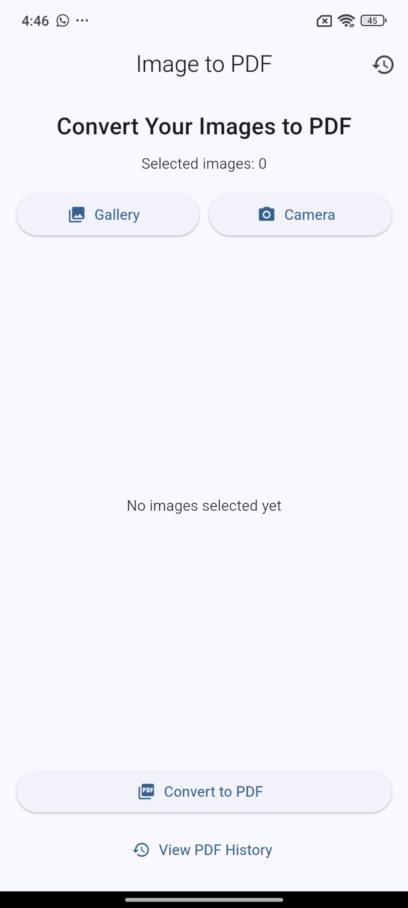
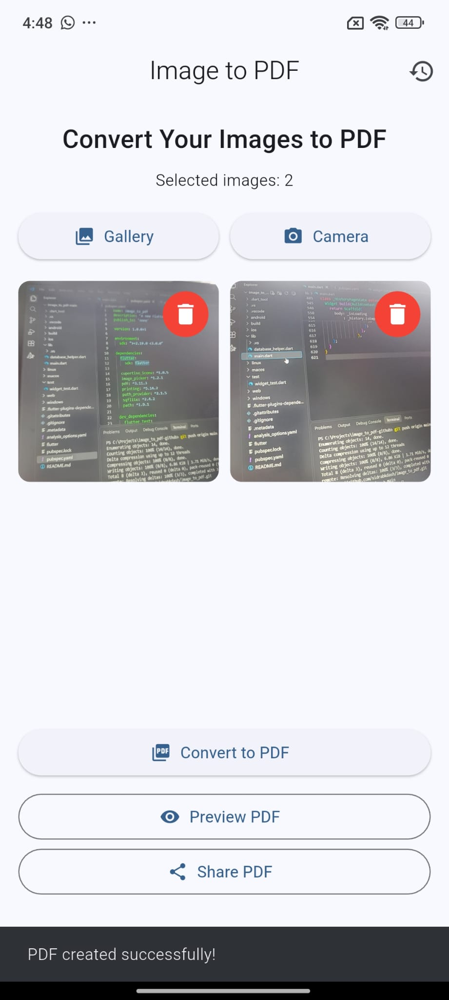
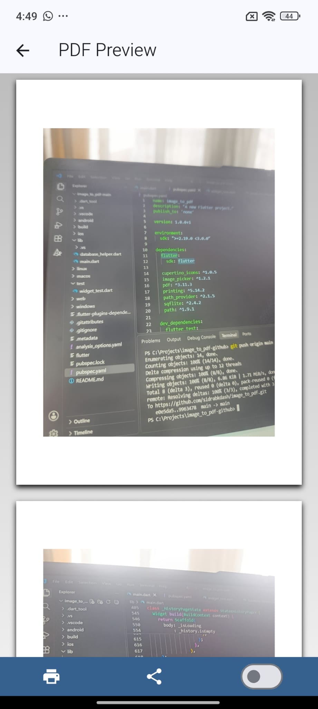

# Image to PDF – Mobile Document Scanning Application


## 1. Project Overview


Image to PDF is a Flutter-based mobile application that allows users to select or capture images and convert them into PDF documents.


The application provides a simple interface for creating, previewing, saving, sharing, and managing PDF files.


## 2. Main Features


- **Select Images:** Choose one or multiple images from the device gallery.

- **Capture Images:** Take photos directly using the device camera.

- **Image Management:** View selected images and remove unwanted images.

- **PDF Conversion:** Convert selected images into a single PDF document.

- **PDF Preview:** Preview generated PDF documents.

- **PDF History:** View previously generated PDF files.

- **Save PDF Files:** Save PDF documents on the device.

- **Share PDF Files:** Share generated PDF documents.

- **Delete PDF Files:** Remove saved PDF records from the history.


## 3. Technologies Used


| Technology | Purpose |

|---|---|

| Flutter | Mobile application development |

| Dart | Programming language |

| SQLite | Local database storage |

| image_picker | Image selection and camera access |

| pdf | PDF document generation |

| printing | PDF preview and sharing |

| path_provider | Access application storage directories |

| sqflite | SQLite database integration |

| path | File path management |


## 4. Database


The application uses SQLite for local data storage.


The `pdf_history` table stores information about generated PDF documents, including:


- PDF ID

- File name

- File path

- Creation date and time


This allows users to access and manage previously generated PDF documents.


## 5. Project Structure


```text

image-to-pdf/

│

├── lib/

│   ├── main.dart

│   └── database_helper.dart

│

├── android/

├── ios/

├── linux/

├── macos/

├── windows/

├── web/

│

├── test/

├── pubspec.yaml

├── pubspec.lock

└── README.md

```

# Image to PDF – Mobile Document Scanning Application


## 1. Project Overview


Image to PDF is a mobile application developed using Flutter and Dart. It allows users to select images from their device or capture photos using the camera and convert them into PDF documents.


The application also provides PDF preview, local storage, PDF history management, sharing, and deletion features.


## 2. Main Features


- **Select Images:** Choose one or multiple images from the device gallery.

- **Capture Photos:** Take pictures directly using the camera.

- **Manage Images:** View selected images and remove unwanted images.

- **Convert to PDF:** Convert selected images into a PDF document.

- **PDF Preview:** Preview the generated PDF document.

- **Save PDF Files:** Store generated PDF documents locally.

- **PDF History:** View previously created PDF documents.

- **Share PDF:** Share saved PDF documents with other applications.

- **Delete PDF:** Remove unwanted PDF documents from the application.


## 3. Technologies Used


| Technology | Purpose |

|---|---|

| Flutter | Mobile application development |

| Dart | Programming language |

| SQLite | Local database management |

| image_picker | Selecting images and capturing photos |

| pdf | Generating PDF documents |

| printing | PDF preview and printing |

| path_provider | Accessing application storage directories |

| sqflite | SQLite database integration |

| path | File path management |


## 4. Database


The application uses SQLite for local data management.


The database contains a table named `pdf_history` to store information about generated PDF documents.


This allows users to view and manage their previously created PDF files through the application.


## 5. Project Structure


```text

image-to-pdf/

│

├── lib/

│   ├── main.dart

│   └── database_helper.dart

│

├── screenshots/

│   ├── 01-home-screen.jpg

│   ├── 02-images-selected.jpg

│   └── 03-pdf-preview.jpg

│

├── android/

├── ios/

├── web/

├── windows/

├── linux/

├── macos/

│

├── test/

├── pubspec.yaml

├── pubspec.lock

└── README.md

```


## 6. Installation and Setup


### Requirements


- Flutter SDK

- Dart SDK

- Android Studio or Visual Studio Code

- Android device or emulator


### Run the Application


1. Clone the repository:


```bash

git clone https://github.com/sidrabkdash/image-to-pdf.git

```


2. Open the project directory:


```bash

cd image-to-pdf

```


3. Install dependencies:


```bash

flutter pub get

```


4. Run the application:


```bash

flutter run

```


## 7. Testing


The project was checked using the following Flutter commands:


```bash

flutter analyze

flutter test

```


Both commands completed successfully during development.


## 8. App Screenshots

### Home Screen



### Selected Images



### PDF Preview



## 9. Project Repository

**GitHub Repository:**

https://github.com/sidrabkdash/image-to-pdf

## 10. Conclusion

Image to PDF provides a simple and convenient way to convert images into PDF documents using a mobile application.

The project combines Flutter development, image selection, camera integration, PDF generation, local database management, and file sharing in one application.

---

**Project:** Image to PDF – Mobile Document Scanning Application

**Platform:** Flutter

**Language:** Dart

**Database:** SQLite